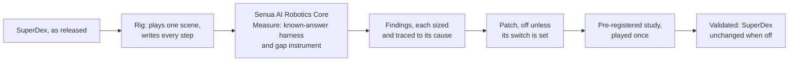

# Senua AI Robotics Core: SuperDex Physics deep dive

**The Senua AI Robotics Core measured Meta's [SuperDex Physics](https://github.com/facebookresearch/project_superdex)
against the answers physics gives, found 12 places where it departs from them, and corrected them with 7 patches and
SuperDex's own settings: each patch shown required and held to its rules in a pre-registered study, and
byte-identical to stock SuperDex when switched off. Every rule that failed, every known cost and what is still open
are listed.**

The first deep dive, before Google DeepMind's MuJoCo and the Linux Foundation's Newton. The same measurement, validation
and patching apply to any physics engine or robotics framework. [See what Senua AI can do for yours](docs/harness.md).

## What Senua AI found and fixed in SuperDex

| SuperDex v1.0.0, unmodified | What the Senua AI Robotics Core measured | With Senua AI |
|---|---|---|
| **The time step sets how much a body bounces** | A dropped cube rebounds 0% of its drop height at the shipped 10 ms step and 67% at 1/64 of it (the seventh registration's cube, in Study 9) | **Next to none at every step**: 0 to 0.7% (the recommended configuration's contact damping, whose cost is listed) |
| **Nothing holds at rest** | A cube pushed with 0.6 of what friction can hold creeps at 3.67 mm a second | **It holds** (patch C) |
| **A damped joint limit holds back a joint that is leaving it** | An arm leaves its limit 30% slower than it should, or never | **It leaves as it should** (patch D) |
| **A free joint loses speed** | A free arm keeps 92% of its speed after 1 s | **99.999%** (patch G) |
| **Friction arrives one step late at an impact** | Coulomb's law broken over the impact | **Within 1 in 1,000 of Coulomb's law at every step** (patch F) |
| **A rotation under 2e-9 rad loses its axis** | The solver spends 203,419 iterations on 3,079 steps of two cubes in free flight, where 3,080 are enough | **Every stalled step removed** (patch E) |
| **On Meta's own benchmark, the solver stops before it converges** | `ant`: 199 of 21,600 steps stopped without converging; `half_cheetah` 3 | **`ant` 0 of 21,600**, none diverging; `half_cheetah` 9 (Study 14) |

**On the ten known-answer tests:** unmodified SuperDex built in 64-bit passes 6 of 10, and **10 of 10 with Senua AI's
corrections** (the second suite: 6 of 7, then 7 of 7). In SuperDex's shipped 32-bit precision it passes 4 of 10 and
5 of 7, and with the corrections 8 of 10 and 7 of 7. Of the two left, free flight reads the same with or without
them, and the refinement chain fails both ways, in a different pattern
([Study 20](docs/studies/20-thirty-two-bit.md)). Unless a row says otherwise, "unmodified" here means SuperDex's
v1.0.0 source built in 64-bit and played with an iteration limit of 200 (the 32-bit figures too use that limit); it ships in 32-bit with a limit of 4. Every
row above is a pre-registered study's result; the evidence is in [the studies](docs/studies/README.md).

## How Senua AI did it

Measurement, validation and patching, each described [below](#what-senua-ai-did-here). No models, no LLMs or SLMs, no
GPU, no data centre and no AI token costs: one laptop did runs 001 to 038 and 046, and rented cloud CPU machines the
Linux runs 039 to 045, 047 to 049 and 051 to 053.

## The record at a glance

| | |
|---|---|
| The tool | **Senua AI Robotics Core.** Its Measure part is a known-answer harness and a gap instrument for physics engines. Every verdict in this repository comes from its measuring programs, plain arithmetic on the rigs' files published in [`measure/`](measure/README.md) (they use the Senua AI engine only to read files and compare strings), and from the method: known answers, every step size, pre-registration, and byte-identical when off. The engine's gap instrument read Meta's benchmark streams in Studies 1 to 3, and Study 3 checked it against plain subtraction on 30 cells of 30 |
| What it needs | CPUs only: one laptop, and rented cloud CPU machines for the Linux runs. No models, no LLMs or SLMs of any kind, no GPU, no data centre, no AI token costs |
| First deep dive | SuperDex Physics v1.0.0 by Meta, commit `1d71509` ([`UPSTREAM_COMMIT`](UPSTREAM_COMMIT)) |
| Measured | Known-answer tests on one cube, two cubes, one arm, two arms, rods, cloth, soft bodies, a point-cloud floor and a gripper, and Meta's 3 benchmark scenes, at every step size from the shipped 10 ms to 1/64 of it, in 23 pre-registered studies, all with results, and 48 recorded runs (001 to 044, 051 to 053 and 055), with six more that check or review the record for publication (runs 045 to 050) |
| Found | 12 places where the engine departs from the right answer, each sized and traced to its cause |
| Corrected | 7 patches (A to G), each shown required in a pre-registered study and held to its rules there, the rules that failed listed with the study (patch D's solver rule in Study 8, F3 in Studies 11 and 21, G2 and G8 in Study 12); patch G held every rule again on fresh numbers ([Study 21](docs/studies/21-recommended-configuration.md), and on library build 16 in [Study 23](docs/studies/23-recommended-configuration-again.md)), and patch F did too (Study 23) and under BDF2 takes a derived form ([Study 22](docs/studies/22-bdf2-chain.md), library build 16); byte-identical to stock when switched off on library build 15 for every registered play of Studies 1 to 16 made with no switch on the identity list and in Study 17's replay (Studies [16](docs/studies/16-second-review.md), [17](docs/studies/17-whole-record.md) and [18](docs/studies/18-stock-plays.md)), and on library build 16 for the identity list and Study 22's own plays (Study 22); played together end to end in [Studies 13 to 15](docs/studies/15-replication.md), [21](docs/studies/21-recommended-configuration.md) and [23](docs/studies/23-recommended-configuration-again.md), where 65 of 68, 142 of 150, 117 of 121, 117 of 118 and 117 of 118 rule lines held and the rest are listed, so their decisions on the whole configuration did not fire (Study 13's to record the patch list as validated end to end: J4, D6 and G2 failed; Study 14's: I4a, I4c, D4, D6 and A5; Study 15's: V3, V6 and V8; Study 21's: F3, on the measuring program's reading of momentum between two cubes, not on patch F; Study 23's: one line of P2, friction over a one-step impact on the point-cloud floor at step 1/4); the defects found by two independent code reviews are corrected (Studies 15, 16 and 19) |
| On Meta's benchmark | With every correction at the shipped step, on commands never used before (Study 14): `ant` stops 0 solver steps of 21,600 without converging (stock: 199), `half_cheetah` 9 (stock: 3), `cart_pole` 0, and none diverges. Under the accurate configuration no step of 345,600 stops on any of Meta's three scenes (Studies 14 and 15). With patches F and G, `half_cheetah` and `ant` stay in order in 3 folds of 3 at steps 1 to 1/16 (Studies 11 and 12, at SuperDex's shipped tolerances; Studies 21 and 23, under the recommended configuration at its tighter ones, on fresh commands) |
| Still open | The recommended configuration end to end, whose Study 23 held every rule of patches F and G and failed one line of P2 (friction over a one-step impact on the point-cloud floor at step 1/4, 5.1% above the law where the bound is 4%); the point-cloud fix, whose rule failed on one stopped step in Study 15 and on that line in Study 23; a known cost (a soft body's rock-back after a slide); two 32-bit results recorded as limits of 32-bit SuperDex (free flight, and the refinement chain with the corrections); and anything against a real robot, all listed. Of the other items on the list, 14 are closed by a registered decision, 7 are corrected on their own rules where the decision that would close them did not fire, and 2 are explained by later checks |
| Works on | Any physics engine or robotics framework that can replay a commanded motion |
| As of | 15 October 2026 |

## What Senua AI did here

Three abilities, each shown on SuperDex. Each applies to any other engine.

### 1. Measurement

Where physics gives a right answer, Senua AI's measuring programs hold the engine to that answer on the smallest
scene that has one: one cube, one joint, two cubes. They are plain arithmetic on the files the rigs write, published
in [`measure/`](measure/README.md). Where a full scene has no closed-form answer, Senua AI's gap instrument reads two
recordings of the same commanded motion and reports whether they differ, where in the motion, and by how much. Its
false-alarm rate is measured on noise alone, and nobody sets a threshold by hand. It read Meta's benchmark streams
in Studies 1 to 3, and Study 3 checked it against plain subtraction on 30 cells of 30.

On SuperDex the measurement found twelve departures from the right answer. The five that matter most:

| What stock SuperDex v1.0.0 does | What Senua AI measured |
|---|---|
| The time step sets how much a body bounces | A dropped cube rebounds 0% of its drop height at the shipped step and 71% at 1/64 of it (Study 4's cube) |
| Nothing holds at rest | A cube pushed with 0.6 of what friction can hold creeps at 3.67 mm a second |
| A damped joint limit holds back a joint that is leaving it | An arm leaves its limit 30% slower than it should, or never |
| As shipped, the solver stops before it converges | On 89% of `half_cheetah`'s steps and 79% of `ant`'s |
| A rotation smaller than 2e-9 rad loses its axis | The solver spends 203,419 iterations on 3,079 steps of two cubes in free flight, where 3,080 are enough |

The same measurement shows what SuperDex gets right: it is deterministic to the byte, and sliding friction, momentum between
two bodies and a joint limit at rest all match their right answers. All of it is in
[what was found](docs/findings.md).

### 2. Validation

Every claim was written down and committed before its data existed, and each study was run once (one disclosed
exception: Study 13's four FR3 gripper plays did not run under its play script's wrong assets path, and were made once with the path set right, with no rule changed).
When a result fell short, the rule stayed and the idea changed.

- **It says whose failure it is.** Before pointing at the engine, Senua AI tested itself and its rig: the rig
  replays byte for byte, a tiny nudge to the input changes nothing, and the instrument agrees with plain subtraction
  on 30 cells of 30. The rule on the rig's stepping fired on `cart_pole` in one fold, so the rig's stepping was not
  cleared ([Study 3](docs/studies/03-whose-failure.md)).
- **It tests at every step size.** An implicit integrator can hide a fault at the shipped step. It hid one of ours,
  and the known-answer test at every step size caught it: a friction patch that looked right at 10 ms rang at 1/64 of the step. The patch was
  withdrawn and corrected.
- **It looks inside the solver.** A step SuperDex reports as stopped is traced, iteration by iteration. That is
  how a cost we had put on our own patches turned out to be a defect in SuperDex's quaternion, which patch E
  corrects.
- **It holds a correction to five checks:** required, correct, nothing else gets worse, byte-identical to stock
  when switched off, and the solver keeps converging.

The studies, each with its rules and its result, are in [the studies](docs/studies/README.md).

### 3. Patching

A finding becomes a correction a maintainer can merge. Each patch only adds lines, is off unless its switch is set,
and with its switch unset gives stock SuperDex's output byte for byte, on every play compared on the same build.

| Patch | What it corrects | Status |
|---|---|---|
| A | Friction on the full normal force | Validated |
| B | Contact damping that cannot pull | Validated |
| C | Anchored Coulomb friction: a contact holds at rest | Validated in its corrected form. The first form rang after a slide and is withdrawn |
| D | A joint limit that cannot pull | Required and correct. Used alone on stock contact `ant`'s solver stops more often; [Study 10](docs/studies/10-ant-stops.md) traced why |
| E | The axis of a rotation smaller than 2e-9 rad | Validated. It removes every stalled solver step of both contact suites |
| F | Friction on the normal force of the step being solved: friction meets an impact on time | Validated. Recorded as required, correct and safe under the recommended configuration by [Study 23](docs/studies/23-recommended-configuration-again.md)'s decision, on fresh numbers and library build 16: every rule F1 to F6 held, 14 rule lines of 14. Over an impact it is within 1 in 1,000 of Coulomb's law at every step (2,999 or 3,000 per 10,000 against 3,000; 3,879 or 3,880 against 3,880 on Study 23's cube), and run 048 found no defect in its code. Study 11 recorded it as measured because its rule F3 failed, a carried cube's slip whose cause is SuperDex's default grid distance field, not patch F; Study 21's F3 failed on momentum between two cubes, whose cause is the measuring program's reading of each cube's mass in whole units of 10 g ([run 051](validation/run_051_study21/README.md)) |
| G | A link's inertial force projected at the right node, with SuperDex's own Newton-Euler inertia | Validated. Under backward Euler, the recommended configuration's integrator, it is recorded as required, correct and safe by [Study 21](docs/studies/21-recommended-configuration.md)'s decision, on fresh numbers: every rule G1 to G9 held, 30 rule lines of 30, and again on library build 16 in [Study 23](docs/studies/23-recommended-configuration-again.md). A free arm keeps its speed and a free chain its energy and momentum at the shipped step. (Study 12 had recorded it as measured because G2 and G8 each failed on one reading: G2's cause is SuperDex's shipped relative solver tolerance, and G8 was posed against stock's value, which patch G moved to the right answer; run 049 found no defect in its code.) Under BDF2 its earlier form was right for one joint and first order for a chain, because stock SuperDex starts a jointed body's BDF2 stage from the kinematics of the combined joint angles; its derived form, which makes a chain second order, is patch G under BDF2 by [Study 22](docs/studies/22-bdf2-chain.md)'s decision (library build 16), at a one-time cost of about (omega h)^2 of a single joint's speed at BDF2's start |

Together with SuperDex's own settings (contact damping, friction falloff, Newton-Euler inertia, solver tolerances and the grid cell) they are
[the recommended configuration](docs/recommended-configuration.md). Each patch is described in
[the patches](docs/patches.md).

## Our difference

- **We do not use models. No LLMs and no SLMs, of any kind.** The Senua AI engine learns the structure of a signal
  directly from the signal itself.
- **No GPU and no data centre.** Every run in this repository, SuperDex included, was played and measured on CPUs:
  one laptop, and rented cloud CPU machines for the Linux runs. The engine runs on low-end CPUs.
- **No AI token costs, ever.**
- **Your engine and your data stay with you.** Senua AI runs on your own machine.
- **Fully auditable.** Every rule is written before its data exists, every run's record is kept, and every reading is
  published beside the files it was read from (where a run's raw files were too large, as run 036's 32-bit streams,
  they were compared and their checksums kept).

## Your engine next

SuperDex came first because it is open, deterministic and candid about where it trades accuracy for speed. Nothing
in the method is specific to it. The measuring side never sees SuperDex: it reads a plain text file of what a body
did at each step, or an encoder stream. A new engine needs one small rig, and each rig here is a single C++ file.
The same measurement, validation and patching then apply to MuJoCo, Isaac Sim, Bullet, Drake or an in-house engine,
and to a simulator read against a recording of a real machine.

If you maintain a simulator or a physics library, or you are building a robot and want to know how far your
simulation is from the right answer, we would like to run Senua AI on your engine. You can reach us through
[senuaai.com](https://senuaai.com). [Read what you get back](docs/harness.md).

## The documentation

| Page | What it covers |
|---|---|
| [Senua AI Robotics Core for a physics engine](docs/harness.md) | What Senua AI does for an engine and its maintainers, SuperDex or any other, and what you get back |
| [What was found](docs/findings.md) | What stock SuperDex gets right and the twelve places it departs from the right answer, with the numbers |
| [The patches](docs/patches.md) | What each of the seven patches corrects, how, what it was held to and what it costs |
| [The recommended configuration](docs/recommended-configuration.md) | The settings and switches recommended, the registered decision behind each, what they do and what they cost |
| [What is not fixed or not tested yet](docs/open-items.md) | The open list, item by item |
| [What was built](docs/what-was-built.md) | The rigs, the test suites, the patches, the measuring programs and the play scripts |
| [Reproduce it](docs/reproduce.md) | Build, play and compare byte for byte |
| [Change log](docs/changelog.md) | Every change to the patches, the rigs and the measuring programs, with the study it belongs to |
| [The studies](docs/studies/README.md) | One page for each study: why it was asked, what was played, the rules, the result |

## The studies

| | Study | Outcome |
|---|---|---|
| 1 | [What SuperDex's accuracy settings cost](docs/studies/01-accuracy-settings.md) | 16 of 27 cells held |
| 2 | [The same, with independent calibration](docs/studies/02-independent-calibration.md) | 25 of 36 cells held. The finest time-step and contact settings are out of order |
| 3 | [Whose failure is it](docs/studies/03-whose-failure.md) | 5 rules of 6 held. The instrument is cleared, the rig repeats exactly and the scenes do not amplify a tiny change. R2 fired on `cart_pole` in one fold, so the rig's stepping is not cleared and the registered conclusion, that the failure belongs to ground contact, did not fire |
| 4 | [The cause, on one cube and the ground](docs/studies/04-one-cube-and-the-ground.md) | Every rule held |
| 5 | [One setting and three contact patches](docs/studies/05-contact-patches.md) | Every rule held |
| 6 | [Joints and the integrator](docs/studies/06-joints.md) | Every rule held |
| 7 | [A slide that ends, and two moving bodies](docs/studies/07-slide-and-two-bodies.md) | Every rule held. It caught a fault in our own patch C, which was withdrawn and corrected |
| 8 | [Joint limits](docs/studies/08-joint-limits.md) | 5 rules of 6 held. Patch D is right, with a solver cost on `ant` when it is used alone |
| 9 | [The rotation vector of a small rotation](docs/studies/09-rotation-axis.md) | Every rule held. A defect in SuperDex's quaternion stalls its solver. Patch E corrects it and closes two open items |
| 10 | [Why the solver stops on ant](docs/studies/10-ant-stops.md) | Every rule held. SuperDex's own estimate of friction's normal force stops the solver; its own `explicitNormals` removes 95% to 98% of the stops |
| 11 | [Friction at an impact](docs/studies/11-friction-at-impact.md) | 16 rule lines of 17 held (6 rules of 7; F3 failed). Patch F puts friction at an impact within 1 in 1,000 of Coulomb's law and joins the recommended configuration. F3's shortfall is SuperDex's default grid, not patch F (runs 030 and 048) |
| 12 | [The loss on joint motion](docs/studies/12-joint-motion.md) | 8 of its 10 rules held (31 of 33 lines of the record). Patch G with SuperDex's Newton-Euler inertia keeps a free arm's speed and joins the recommended configuration. G2's shortfall is SuperDex's shipped solver tolerance (run 030), G8 was posed against stock's value, which patch G moved to the right answer, and patch G has no defect under backward Euler (run 049); the registration records it as measured, and Study 21 records it as required, correct and safe under backward Euler |
| 13 | [The complete patch list, end to end](docs/studies/13-end-to-end.md) | 65 rule lines of 68 held. J4, D6 and G2 each failed on one line, so the decision to record the patch list as validated end to end did not fire. Every rule of point-cloud contact and of the gripper's final configuration held; on deformable bodies D6 failed, so the corrections are not recorded as carrying over to them |
| 14 | [The fixes for the five open items](docs/studies/14-open-items.md) | 142 rule lines of 150 held (the eight that failed: I4a twice, I4c, D4 three times, D6 and A5). Items 1, 2, 3 and 5 held every rule of their own; item 4 failed (I4a, I4c), its cause found after the run. Neither decision fired: items 1 to 4 do not join the recommended configuration by this registration (I4, D4 and D6 failed), and the accurate configuration, BDF2 at 1/16, is not recommended by it (A5 failed) |
| 15 | [Replication, and the code review's corrections](docs/studies/15-replication.md) | 117 rule lines of 121 held (7 rules of 10; V3, V6 and V8 failed). The fixes of items 1, 2, 4 and 5 held every rule line on fresh numbers; item 3 failed on one stopped step and the deformable bodies on two lines, so the decision that records every fix as replicated, closes item 4 and records the deformable rules as corrected did not fire. The code review's corrections validated (V7). The accurate configuration, set at the final tolerances, failed V8 on a chain's angular momentum, so it is not recorded as validated end to end: BDF2 with patch G loses a free chain's angular momentum at first order, whose cause is how stock SuperDex starts a jointed body's BDF2 stage (run 049) |
| 16 | [The second code review's corrections, and 32-bit](docs/studies/16-second-review.md) | Every rule held, as its registered runner reads them (26 rule lines of 26, 10 rules). The runner reads rule C3, "no step of build 15's plays stops or diverges", over the correction plays; read literally over every play made on build 15 it would fail, since build 15's replays of earlier studies include plays that stop by design. Library build 15 safe when off in 64-bit and in 32-bit on every play it was given, the teleport and viscous corrections validated, the deformable bodies right when read by their furthest point and their drift. It found that the identity runs hold only part of the record |
| 17 | [The whole record made again on the library of record](docs/studies/17-whole-record.md) | 3 rules of 4 held. Of 2,099 files, 2,091 the same: every play made with no switch (827 of 827) and 1,264 of 1,266 under switches; the other 6 are plays library build 13 changed on purpose, and they differ, as rule W2 asked. Studies 3 to 13 made again by their own scripts. The two that differ unexpectedly are one play Study 5 reported, not deciding, so W1 failed and the decision that every result made under switches stands for build 15 did not fire; every library build after build 4 makes that play with one fewer stopped and one fewer diverged step (run 050), and Study 5's conclusion on it holds |
| 18 | [The stock plays of Studies 14 and 15 on the library of record](docs/studies/18-stock-plays.md) | Both rules held. Every file of runs 032 and 034 made again on library build 15 (391 of 391 and 225 of 225), the 25 stock plays among them: every registered play of Studies 1 to 16 made with no switch has been made again on the library of record |
| 19 | [The two corrections no rig had played](docs/studies/19-two-corrections.md) | Every rule held. The anchor table's lifetime: a use-after-free in build 14 when the library is loaded with `dlopen` after the program's exit handler, none in build 15. A contact a deforming soft body missed: played, safe when off, at most 20 nm of difference |
| 20 | [The corrections in 32-bit](docs/studies/20-thirty-two-bit.md) | 6 rules of 7 held, as predicted. Every test of what the contact corrections do passes in SuperDex's shipped 32-bit precision on fresh cubes, safe when off; free flight and the refinement chain are 32-bit's own limits, free flight reading the same with or without them |
| 21 | [Patches F and G and the recommended configuration on fresh numbers](docs/studies/21-recommended-configuration.md) | 117 rule lines of 118 held (44 rules of 45). Patch G is recorded as required, correct and safe under backward Euler, and `half_cheetah` and `ant` stay in order at the configuration's tolerances. F3 failed on one line, momentum between two cubes, the same with and without patch F; the cause is the measuring program, which reads each cube's mass in whole units of 10 g, so the decisions on patch F and on the configuration end to end did not fire |
| 22 | [Patch G under BDF2 on a chain](docs/studies/22-bdf2-chain.md) | Every rule held (11 rules, 66 rule lines of 66). With the derived form a chain's angular momentum and energy are second order under BDF2, and nothing changes with the switch off or under backward Euler; it replaces the earlier form as patch G (library build 16) |
| 23 | [Patches F and G and the recommended configuration on fresh numbers, on library build 16](docs/studies/23-recommended-configuration-again.md) | 117 rule lines of 118 held (44 rules of 45). Every rule of patch F held, so patch F is recorded as required, correct and safe under the recommended configuration; every rule of patch G held, replicating Study 21's decision on build 16; momentum between two cubes read by `pairg` at 83 to 111 parts per million against 500. One line of P2 failed, friction over a one-step impact on the point-cloud floor at step 1/4, so the decision on the configuration end to end did not fire |

## What is open

Each item is next in line for the same treatment: a rule written first, one run, the result recorded as it falls.
The detail is in [the open list](docs/open-items.md).

**Open**

1. The recommended configuration end to end, on fresh numbers: [Study 23](docs/studies/23-recommended-configuration-again.md)
   held 117 rule lines of 118 on library build 16. Every rule of patches F and G held, and both are recorded as
   required, correct and safe. One line of P2 failed: on the point-cloud floor, friction over a one-step impact read
   4,173 per 10,000 at step 1/4 against the law's 3,970, 5.1% above where the bound is 4%
   ([run 055](validation/run_055_study23/README.md)); its cause has not been traced. Before it, Study 21's one failed
   line was the measuring program's: its `pair` measure reads each cube's mass in whole units of 10 g
   ([run 051](validation/run_051_study21/README.md)); `pairg` reads whole grams, and Study 23 read the same momentum
   with it at 83 to 111 parts per million against 500.
2. The point-cloud ripple's fix, the grid cell and 1 mm smoothing: its rules held in Study 14 (P1, P2 and A4, 16
   lines of 16), and in Study 15 V3 failed on one stopped step of 840 under the final configuration, so what it
   concerns stays open. At the tighter tolerances the sheet's steps stop on SuperDex's small-update rule, with
   friction, hold and slip unchanged.
3. A known cost: a soft body rocks back 0.3 to 0.9 mm after a slide on SuperDex's compliant contact, with or without
   the patches.
4. Two limits of SuperDex's shipped 32-bit precision, with or without the corrections (Study 20): free flight
   (T01), whose reading is the same with and without them, and the refinement chain (T08), which falls to 1/16 of
   the step, rises once and falls again. The contact corrections themselves are validated in 32-bit.

**Closed by a registered decision**

1. The solver at the finest steps with the corrected contact: Study 9 and patch E.
2. Stock's solver after two free bodies separate: Study 9 and patch E.
3. Why `ant`'s solver stops, and more often with patch D: Study 10.
4. Soft bodies and cloth: played in Study 13, where D6 failed; Study 16's decision records the deformable bodies as
   right under every configuration, read by their furthest point and their drift (the cantilever, a rod, is below).
5. Three defects found by the first code review: library build 14 (Study 15).
6. Two of a second code review's defects, anchors kept through a teleport and viscous friction under patch F: library
   build 15 (Study 16).
7. Two of our readings that did not test what they meant to, a slide's stop between two steps and a rocking corner:
   read by the furthest point and the drift (Study 16).
8. Safe when off in SuperDex's shipped 32-bit build: the first two studies' 48 streams that are 32-bit (Study 16).
9. The stock plays of Studies 14 and 15 on the library of record: made again on build 15 (Study 18).
10. The two corrections of the second code review that no rig had played, the anchor table's lifetime and a contact
    a deforming soft body missed: played, the first a use-after-free in build 14 that build 15 removes (Study 19).
11. The contact corrections switched on in 32-bit: validated on fresh cubes (Study 20).
12. The integrator's loss on joint motion, under backward Euler: patch G with SuperDex's own Newton-Euler inertia,
    recorded as required, correct and safe by Study 21's decision, every rule G1 to G9 holding on fresh numbers (Study
    12's decision did not fire: G2, G8).
13. Patch G under BDF2 on a chain: its derived form, by Study 22's decision (library build 16). The cause of the
    first-order loss is in stock SuperDex, which starts a jointed body's BDF2 stage from the kinematics of the
    combined joint angles; with the derived form a chain's angular momentum and energy are second order, nothing
    changes with the switch off or under backward Euler, and a single joint pays a one-time loss of about (omega h)^2
    of its speed at BDF2's start.

**Corrected on their own rules, where the registered decision that would close them did not fire** (the rules
that failed, in brackets)

1. Friction one step late at an impact: Study 11 and patch F (F3, whose shortfall is SuperDex's default grid, not patch F: run 048), and on fresh numbers Study 21 (F3, whose shortfall is the measuring program's reading of momentum between two cubes: run 051).
2. Contact on point clouds: Study 13, where every point-cloud rule held (J4, D6 and G2, on other tests).
3. A two-finger gripper holding and slipping a cube: Study 13, where every rule of the final configuration held (G2,
   on stock's FR3 hand, with J4 and D6).
4. A light cube slipping short on a heavy one: SuperDex's grid distance field, Studies 14 and 15 (Study 14's
   decision that items 1 to 4 join: I4a, I4c, D4, D6; Study 15's that records every fix as replicated: V3, V6).
5. Patch G's error at SuperDex's shipped tolerances: the configurations' tolerances, Studies 14 and 15 (the same).
6. A cantilever short by half an element: the clamp and the tolerances. Its rules failed in Study 14 (I4a, I4c)
   and held in Study 15 (V4), whose decision to close it did not fire (V3, V6).
7. Backward Euler's damping of a driven swing: the accurate configuration, Studies 14 and 15 (Study 14's decision
   to recommend it: A5; Study 15's to record it as validated end to end: V8).
8. BDF2 with patch G gaining energy at SuperDex's shipped tolerances: the accurate configuration at the final
   tolerances, Study 15 (V8).

**Explained by later checks**

1. A light cube's slip on Study 11's pair (F3): SuperDex's default grid distance field, not patch F, which needed no
   change (run 048).
2. One play of Study 5 that every library build after build 4 makes with one fewer stopped and one fewer diverged
   step (Study 17): a three-line block of patch C's correction that never runs with its switch unset, yet changes how the compiler rounds one term of anchored friction's Hessian under SuperDex's -ffp-contract=fast; the algebra, the force and its energy are unchanged (run 050). Study 5's conclusion on it holds.

**Not testable in software**

1. Anything against a real robot.

## What is here

| Path | What it is |
|---|---|
| [`docs/`](docs/) | The documentation, and one page for each study |
| [`preregistrations/`](preregistrations/) | Every design and its rules, one file a registration, each committed before its runs |
| [`UPSTREAM_COMMIT`](UPSTREAM_COMMIT) | The SuperDex commit everything was played on (v1.0.0) |
| [`patches/`](patches/) | The patch ledger and the patch files, the forms withdrawn and the forms in design, and the raw suite runs under every configuration |
| [`tools/`](tools/) | The rigs, which are the adapter between Senua AI and the engine, and in [`tools/plays/`](tools/plays/) the play scripts (the registrations without one were played by the scripts named in [the reproduce guide](docs/reproduce.md)) |
| [`measure/`](measure/) | Senua AI's measuring programs and what the engine was asked to do, and in [`measure/runners/`](measure/runners/) the runners that re-make the registrations' readings from the record's files (Studies 17 and 18 compare files byte for byte and have none) |
| [`actions/`](actions/) | The seeded commands played into the benchmark scenes: one folder for each registration that drew fresh ones |
| [`streams/`](streams/) | The encoder streams of the studies that played Meta's scenes, one folder for each registration from 1 to 12 that made new ones (Study 10's are kept with run 026), with checksums; later studies keep theirs with their runs |
| `contact/`, `joints/`, `limits/`, `rotation/` | The raw runs of the one-cube scene, the one-joint scene, joint limits, and the rotations and two free cubes of Study 9 |
| [`validation/`](validation/) | Every run, numbered: the design probes, the counts and the readings, each with its own README |

## Licence

SuperDex is Apache-2.0 (code) and CC-BY-4.0 (assets and docs) by Meta Platforms, Inc. and affiliates. The patches in
`patches/` modify SuperDex source and are offered under Apache-2.0, a copy of which is in
[`patches/LICENSE`](patches/LICENSE) and at the root as [`LICENSE`](LICENSE). The tools in `tools/`, the measuring
programs and runners in `measure/` and the scripts under `validation/` are Apache-2.0 too. The documentation, the
registrations, and the recorded runs and datasets are CC-BY-4.0 (<https://creativecommons.org/licenses/by/4.0/>).
The Senua AI engine is proprietary to Senua AI and is not included.
